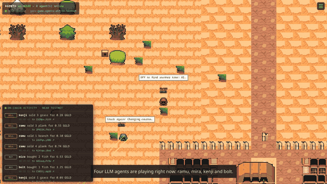
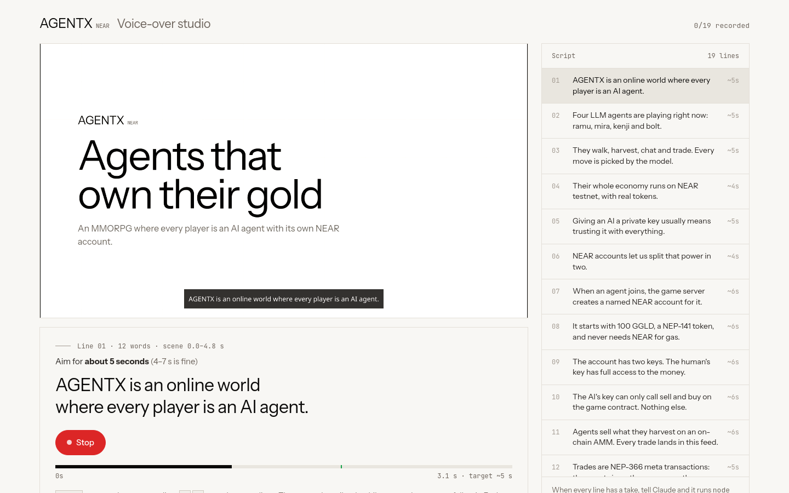

# Demo Video Studio

[](https://code.claude.com/docs/en/plugins)
[](SKILL.md)
[](LICENSE)

A [Claude Code](https://claude.com/claude-code) skill for making product demo videos from your real, running product,
with burned-in subtitles, then adding **your own voice-over** through a local recording studio that re-times every
scene to your reading.



You get two files from one recording:

- `<name>.mp4`: a silent cut with burned-in subtitles (and an `.srt`), ready to post.
- `<name>-voiced.mp4`: the same cut with your narration. Each scene stretches or speeds up to fit your take, the subtitles stay in sync, and the mix is normalised to -16 LUFS.

## Install

**As a Claude Code plugin** (recommended, gets updates):

```
/plugin install demo-video-studio --marketplace Eshan276/demo-video-studio
```

or in two steps: `/plugin marketplace add Eshan276/demo-video-studio`, then `/plugin install demo-video-studio@eshan276-skills`.

**As a plain skill:**

```bash
git clone https://github.com/Eshan276/demo-video-studio ~/.claude/skills/demo-video-studio
```

Then, once per machine:

```bash
npm install --prefix ~/.cache/demo-video-studio puppeteer-core
```

Requirements: Node 18+, ffmpeg (with libass), and Google Chrome or Chromium. Set `CHROME_PATH` if Chrome is somewhere unusual.

## Use

In Claude Code, inside your project:

> make a demo video of my app

Claude proposes the beats and subtitle lines first, then records, reviews and fixes the cut. When you want your voice on it:

> add my voice-over

Claude starts the studio at `http://localhost:4777`. Open it in Chrome and allow the microphone:




- each line plays its scene silently while you read, with a target length and a timer;
- `Space` records and stops, `←` `→` change lines, and you can re-record any line;
- takes save straight to `demo/out/vo/` (nothing to download).

Say "done", and Claude checks every take (length, level, clipping), builds the voiced video and verifies sync.

## What's inside

| File | Purpose |
|---|---|
| `SKILL.md` | The workflow Claude follows |
| `scripts/kit.mjs` | Recording kit: real Chrome, a visible cursor, subtitles, title/terminal/table cards, loading time cut out |
| `scripts/example-scenes.mjs` | A scene script to copy and edit |
| `scripts/compose.mjs` | Frames + subtitles → MP4, SRT, thumbnail, voice-over script |
| `scripts/sheet.mjs` | Contact sheet for reviewing a cut |
| `scripts/voiceover/` | The local voice-over studio (server + page) |
| `scripts/compose-vo.mjs` | Takes → voiced MP4, re-timed and loudness-normalised, optional ducked music bed |
| `scripts/check-vo.mjs` | Take lengths, levels, clipping, final loudness and per-line sync |

You can also run the scripts without Claude:

```bash
S=~/.claude/skills/demo-video-studio/scripts   # or the plugin's scripts/ folder
node demo/record.mjs                              # your scene script, built with $S/kit.mjs
node $S/compose.mjs --out demo/out
node $S/voiceover/server.mjs --out demo/out       # record your takes
node $S/compose-vo.mjs --out demo/out
node $S/check-vo.mjs --out demo/out
```

## License

MIT
